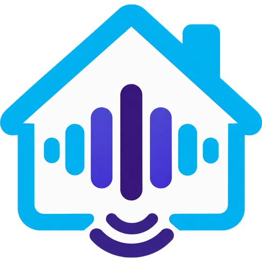

<p align="center"></p>

# Better Assistant for Home Assistant

A Google Assistant-style voice assistant for Home Assistant's Assist: timers, alarms, reminders, notes,
calendar, music, rooms and lights, the bed, cameras, a health report and more, set up automatically from
the devices you already have. With an optional Brave Search API key it also answers everyday questions
out loud from the web, without an AI model writing the answer.

> **Unofficial community integration.** This project is not made, endorsed or supported by Brave
> Software. It uses the public [Brave Search API](https://brave.com/search/api/) with your own key.

## What it does

Put it behind Home Assistant's own commands in an Assist pipeline. Anything Home Assistant
understands itself (lights, timers, "what time is it") runs locally as usual. Anything left over
comes to this agent, which:

1. **Answers "what did you hear?"** with the last sentence it received.
2. **Handles its own household skills** (details below): reminders, alarms, notes, household
   messages, a stopwatch, and extra wordings for Home Assistant's built-in timers.
3. **Runs compound commands** such as "turn off the desk lamp and the porch light then play the
   news". It splits the sentence, carries the verb onto bare device names, checks that *every* part is
   a real Home Assistant command (dry run), and only then runs each part through Home Assistant's own
   agent. If any part isn't a command, nothing runs.
4. **Answers locally, with no search:** spelling ("how do you spell necessary"), arithmetic ("what's
   15 percent of 80"), unit conversions ("how many tablespoons in a cup", "350 Fahrenheit in Celsius"),
   holiday and date questions ("how many days until Thanksgiving"), world clock ("what time is it in
   Tokyo"), coin flips, dice and "pick a number between 1 and 50".
5. **Guards against misheard commands:** only question-shaped sentences are searched ("Sorry, I
   didn't catch that." otherwise), and sentences that start like a command or name one of your
   exposed devices or areas are never sent to the web.
6. **Looks it up on the web** with the Brave Search API "LLM Context" endpoint. The API returns
   passages from real web pages; the integration reads out the single sentence that best matches your
   question and names the site: *"From mayoclinic dot org, ..."*. Medicine, health, pets, food safety,
   gardening, films, people and dictionary questions are steered towards trusted sites for that topic.

## Install (HACS)

Requires **Home Assistant 2025.11 or newer** (the agent uses the conversation dry-run matcher
`async_debug_recognize` added in 2025.11, and `satellite_id` routing added in 2025.10).


1. HACS > three-dot menu > **Custom repositories** > add
   `https://github.com/irnutsmurt/Better-Assistant` as type **Integration**.
2. Install **Better Assistant**, then restart Home Assistant.
3. **Settings > Devices & services > Add integration > Better Assistant.**

Manual install: copy `custom_components/better_assistant` into your `config/custom_components/`
folder and restart.

## Getting an API key (optional)

The key is optional. Without one, everything except web search still works.

1. Sign up at the Brave Search API dashboard (`api-dashboard.search.brave.com`).
2. Subscribe to a plan that includes the **LLM Context** endpoint. Brave has offered a free monthly
   credit; check their current pricing, as plans change.
3. Create a key and paste it in the setup dialog. It is checked with one small request (this uses
   1 search from your Brave credit) and stored in
   the config entry. It is never logged. To change or remove it later use **Reconfigure** on the
   integration.

The **monthly search cap** (default 300) stops searches for the rest of the month once reached, so
you stay inside your plan. The sensor **Brave searches this month** shows the count, with the cap and
remaining searches as attributes. A dictionary question can use two searches when the first doesn't
contain a real definition.

## Use it in an Assist pipeline

1. **Settings > Voice assistants**, open (or add) a pipeline.
2. Set **Conversation agent** to **Better Assistant**.
3. Turn **Prefer handling commands locally** on. This matters: Home Assistant then runs every command
   it recognises itself, and only unrecognised sentences reach this agent.
4. Pick your speech-to-text and text-to-speech engines as usual.

Or let **Voice setup** (below) do all of this for you.

## Voice setup (optional)

After the API key step, Better Assistant offers **Set it up for me** (or **Skip**). You can run it
later from **Configure > Set up voice**. It looks at what you already have and keeps it: any
speech-to-text or text-to-speech engine (Home Assistant Cloud, Wyoming Whisper/Piper or another
integration), existing Wyoming entries and installed add-ons are reused, not replaced. Then it:

1. **Speech engines.** On Home Assistant OS or Supervised (installs with an add-on store) it shows
   what it will download (roughly 0.5 GB for the Whisper add-on plus its model, 0.3 GB for Piper
   plus one English voice), then installs and starts **Whisper** and **Piper** and sets Whisper's
   model, language (`en`) and, where the add-on has the option, the initial prompt *"Questions and
   commands for a smart home."* The model is picked for the hardware: `tiny-int8` on a Raspberry Pi 3
   or anything under 3 GB of memory, `base-int8` on a Pi 4/5 with 4 GB or more, `base.en` on an x86
   machine, `small-int8` on x86 with 8+ cores and 8 GB. On Docker or Core installs (no add-on store)
   it shows the `docker run` commands for `rhasspy/wyoming-whisper` (port 10300) and
   `rhasspy/wyoming-piper` (port 10200) and asks where they run.
2. **Wyoming.** Confirms the "Discovered" Wyoming cards for the add-ons, or adds Wyoming by host
   and port.
3. **Voice assistant.** Creates (or updates) a pipeline named **Better Assistant** with this
   integration as the conversation agent, those speech engines, language English and **Prefer
   handling commands locally** on. A checkbox makes it the preferred assistant.
4. **Speakers.** Ticked voice speakers (Assist satellites such as Voice PE or ESPHome; never Cast or
   Google speakers) have their **Assistant** setting switched to it.

Nothing here can break the integration: if a step fails you get a summary of what was done and
what is left to do by hand. A first-time setup creates the pipeline a moment after you finish and
confirms it in a notification.

Voice needs a **speech-to-text engine**. Whisper is the free local one; Nabu Casa's Home Assistant
Cloud and other speech-to-text integrations work too, and without any you can still type in the
Assist chat. Speech-to-Phrase only understands a fixed list of home commands, so it can't hear the
open questions this agent answers.

Nothing here needs a Home Assistant Cloud subscription. Tips if you set things up yourself:

- **Whisper model:** use `base-int8` or `base.en` or larger. `tiny` is fast but mishears short
  questions, and a misheard question becomes a strange web search. An initial prompt such as
  *"Questions and commands for a smart home."* helps.
- **Piper** speaks everything, including alarms, reminders and announcements, which use each
  speaker's own pipeline.
- **Speed:** on a Raspberry Pi 4/5, `base` Whisper takes a second or two per sentence; on an
  x86 mini PC it is near instant. Cloud speech is quicker and more accurate on slow hardware.

## Settings page

**Settings > Devices & services > Better Assistant > Configure** opens a menu:

| Section | What's there |
|---|---|
| Web search | On/off, monthly cap, country (2-letter code), say the source site |
| Behaviour | Question-only guard, compound commands on/off, most parts in one compound command (2-4) |
| Alarms | Default alarm speaker (empty = the one you asked from, a voice speaker, or all), snooze length (1-30 minutes, default 5), Snoozing on/off, snooze limit per alarm (empty = no limit, 1-10; 0 turns snoozing off) |
| Voice speakers, Reminders & notes | Devices found automatically |
| Music, Calendar, Rooms & lights, Thermostat, Cameras & outside, TV, Bed, Health report, Guest mode, Night mode, Broadcast | An on/off switch, the devices found automatically, and that feature's own settings |
| Set up voice | The voice setup above, run again |
| Re-detect devices | Scan again |

### Automatic device detection

You don't match devices by hand. The integration looks at what you already have, using domain,
device class, integration, supported features and area (never names), and pre-fills each section:
voice satellites (and a Music Assistant player on the same device), Music Assistant players, Cast
groups for broadcasts, thermostats, calendars (and the first one that can create events), to-do
lists, people and their phones' notify services, cameras and the Cast TVs that can show them, outdoor
motion/person sensors (Frigate person sensors preferred, indoor rooms skipped; which areas count as
outdoors is guessed from area names and can be changed under Cameras & outside), TVs with their remote
and inputs, lights and light switches per room (status LEDs on Zigbee routers and voice satellites
left out), battery sensors (phones and watches tagged as personal), unavailable devices, and Sleep
Number beds.

Detection runs as soon as the integration is added (or once Home Assistant has started), and again by itself about 30 seconds after you add, remove or move devices, entities or areas. Just press Submit to accept a section. If you change
something, only your changes are stored, separately, so **Re-detect devices** refreshes everything
else without undoing your edits.

## Household skills

These sentences are recognised by the agent itself (with hassil, like Home Assistant's own
commands), before any guard or search. Who is speaking comes from the signed-in user; on a voice
speaker with several people in the house, say the person's name ("remind Sam to ...").

| Skill | Say | What happens |
|---|---|---|
| Reminders | "remind me to call the dentist tomorrow at 3", "remind me at 5 to ...", "remind me to buy milk when I get home / when I leave", "... when I get to work / leave work", "remind Sam to feed the cat at 6 / when she gets home", "what are my reminders", "cancel my reminders", "cancel the reminder to call the dentist" | Kept in the integration's own **Reminders** to-do list. When due, announced on the voice speaker and sent to the person's phone, then ticked off. Places are your Home Assistant zones; if a place has no zone you're told how to add one. A reminder for someone else waits until they're home. Confirmations always give the exact clock time ("tomorrow at 5 AM"). Names are matched against your people and their aliases; an unknown name gets "There's no one named Bob in this home." |
| Alarms | "set an alarm for 7", "wake me up at 6:30 in the kitchen", "set an alarm for 7 everywhere", "move my alarm to the bedroom", "set an alarm for every weekday at 6:45", "what time is my alarm", "cancel my alarm", "snooze", "give me 5 more minutes", "how long is the snooze", "stop the alarm" | Rings with a bundled tone on the speaker you asked from, or where you say: "set an alarm for 7 in the bedroom", "... on the kitchen speaker", "... everywhere" / "on all speakers" (speakers are matched by name, device, area and aliases; voice satellites only). "move my alarm to the kitchen" / "ring my alarm everywhere" changes where without changing the time. One alarm per speaker plus one "all speakers" alarm; a new alarm for the same place replaces the old one. Stop or snooze from any speaker an alarm rings on stops it there and everywhere else it rings. Set from the app, it rings on all voice speakers and also sends a phone and Home Assistant notification. Rings with a bundled tone on that speaker's own media player for up to 10 minutes. Snooze is 5 minutes by default; "snooze for 10 minutes" or "just 5 more minutes" snoozes once for that long (30 minutes at most), and "set the snooze to 10 minutes" changes the default. Snoozes per alarm can be limited ("limit snoozes to 3", "no snooze limit", "turn off snoozing" / "limit snoozes to 0", "turn on snoozing", "how many snoozes do I get"); each snooze says how many are left. A plain "stop" (Home Assistant's own media stop) also ends a ringing alarm. |
| Timers | "set a pizza timer for 20 minutes", "set a 20 minute pizza timer", "add a minute to the timer", "give the pizza timer 5 more minutes", "take a minute off the timer" | Extra wordings handed to Home Assistant's **built-in** timers. Plain "set a timer for 10 minutes" still goes straight to the built-in. |
| Notes | "take a note that the wifi password is on the fridge", "remember that ...", "remember I put the passports in the top drawer", "where did I put the passports", "read my notes", "clear my notes" | **Notes** to-do list. Read back with "my" turned into "your". |
| Messages | "leave a message for Sam that dinner is in the oven", "leave a note that ...", "any messages?" | **Messages** to-do list. Messages are read to the person they're for (or anyone) and then ticked off. |
| Stopwatch | "start the stopwatch", "how long has the stopwatch been running", "stop the stopwatch" | One per voice speaker, in memory. |

Times without AM/PM mean the next time that clock time comes round ("7" said at 6:28 PM is 7 PM).
When a day or date is given ("tomorrow at 3"), 1-6 o'clock means PM for reminders and AM for alarms.

### Timer wordings and Home Assistant's own matcher

Home Assistant has no supported way for an integration to add sentences to its built-in intents;
custom sentences are only read from `config/custom_sentences/`. So the agent matches these timer
wordings itself (from `custom_components/better_assistant/sentences/timers_en.yaml`) and passes them
to the built-in timer intents. That covers voice pipelines that use this agent.

If you also want Home Assistant's own agent to understand them (for example in a pipeline that
doesn't use this integration), copy `custom_sentences/en/better_assistant_timers.yaml` from this
repository into `config/custom_sentences/en/` and restart Home Assistant (or reload Conversation).

## Around the house

Each of these has its own page under **Configure** with an on/off switch, pre-filled from the
devices found in your house. Names you can say (rooms, speakers, lights, cameras, TV inputs, apps,
bed presets, calendars, battery names) come from your own devices, so a sentence that belongs to
Home Assistant itself ("turn off the kitchen lights", "set a timer for 10 minutes", "open the
garage door") is never taken over.

| Feature | Say | Notes |
|---|---|---|
| Music | "play music by Queen in the kitchen", "play my workout playlist", "play the album Abbey Road", "play music like Adele", "play jazz everywhere", "what's playing", "turn it up", "stop the music", "move the music to the bedroom", "stop the music in 30 minutes" | Needs Music Assistant. Plays on the Music Assistant player on the speaker you asked from, or in its room. News and podcast requests go to Home Assistant's own media search. |
| Calendar | "what's on my calendar tomorrow / this week / this weekend", "when's my next appointment", "add dentist to my calendar Friday at 3", "add lunch to the work calendar tomorrow at noon" | Events are an hour long, or all day when no time is said. With a day given, 1-6 o'clock means PM. Pick the calendars to read and the one to write to in settings. |
| Rooms and lights | "turn off the living room", "turn on the kitchen", "turn off the fan in 10 minutes", "turn on the heater for 30 minutes", "dim the kitchen by 30 percent", "brighten the desk lamp", "make the bedroom warmer" | A room means its lights, light-like switches, plugs and fans (fans can be switched off in settings), plus media players when turning off. Never a voice speaker's own LED or player, settings switches or network gear. "turn off the kitchen lights" is left to Home Assistant. Delays need the words second/minute/hour. |
| Thermostat | "make it 2 degrees warmer", "I'm cold", "what's the thermostat set to", "is the heat on", "switch to cooling", "set the thermostat to auto", "eco mode", "turn off the thermostat" | Uses the thermostat in your room (or the first one), and only the modes and presets it supports. |
| Outside and cameras | "is anyone outside", "is anyone at the driveway", "any motion in the back yard", "show the driveway camera on the living room TV", "close the camera" | Person sensors first (Frigate person occupancy), outdoor motion sensors as a fallback: "No one's outside right now. The last person was seen 10 minutes ago." Cameras are shown on detected Cast TVs. |
| TV | "switch the TV to HDMI 2", "switch to the PlayStation", "switch to the game", "open Netflix" | Inputs come from the TV's own source list. Apps open through the TV's remote (Android TV app names are built in; the remote's own list wins). |
| Bed | "set the bed to flat", "set my side to read", "raise my side", "flatten the bed", "set my sleep number to 45", "what's our sleep number", "how did I sleep" | Sleep Number (SleepIQ). Sleepers are matched by name; otherwise pick who sleeps on each side in settings. |
| Health report | "is anything wrong", "are any devices offline", "house status", "which batteries are low", "status of all batteries", "what's the kitchen sensor battery", "what's the battery on my phone" | Offline devices, batteries under 20 percent (phones and watches left out), vacuum errors and waiting updates. |
| Guest mode | "turn on guest mode", "turn off guest mode" | Also a switch. Calendars, notes, reminder lists and sleep data are private, and the locks and garage doors you choose are hidden from Assist until it's off; their earlier Assist setting is put back exactly (including "default"), even after a restart. Search, lights and music still work. |
| Night mode | "turn on night mode" | Off until you switch it on in its settings (so nothing changes on the first night). Then also a switch, and on a schedule (10 PM to 7 AM by default). Only the voice speakers: lowers each one's volume and dims its LED ring, then puts them back. Room lights are not touched. |
| Broadcast | "tell everyone that dinner's ready", "announce the car is here" | Every other voice speaker, plus any media players you add in settings. |
| Help | "what can you do", "what can you do with music" | Only lists the features that are switched on. |

## Security: an optional voice passphrase

Under **Configure > Security** you can set a passphrase. It's stored with the integration, never
shown again, never logged and never spoken. Case, spaces and punctuation don't matter.

- **Locks, garage doors and gates** (the ones listed under Guest mode): opening or unlocking them by
  voice needs the passphrase. Say it in one go ("open the garage door, passphrase purple monkey"), or on
  a voice speaker just say "open the garage door" and answer the question. Closing, locking and asking
  "is the garage door open" need nothing. While this is on, those doors are hidden from Home
  Assistant's own voice commands (which would otherwise open them without asking); their earlier
  Assist setting is put back exactly when you turn it off.
- **Guest mode**: ending it by voice ("turn off guest mode", "the guests left") needs the passphrase
  too. The Guest mode switch in Home Assistant always works without one.
- Three wrong tries pause voice unlocking for 30 seconds, then 1 minute, then 2 minutes, adding a
  minute for each further miss. A right answer, or 6 hours without a miss, starts the count again.
  Pick a person under Security to get a phone notification on every right and wrong try.
- The one-shot form is kept out of "what did you hear". Home Assistant itself may still keep the
  spoken text in its voice pipeline debug view, so prefer the ask-and-answer form on a speaker.

> **Without a passphrase, anyone who can talk to a voice speaker can open these doors and end guest
> mode.** Set one if your speakers can be heard from outside or by guests.

**Tip: "play X".** With "prefer handling commands locally" on, Home Assistant's own media search may
grab a plain "play X" before this agent sees it. If that happens, say "play music by X", "play the
album X" or "play my X playlist", which the built-in search doesn't take, or switch off Home
Assistant's own media search if you'd rather this agent handled every "play".

## "What did you hear?"

The agent remembers the last 5 sentences **it** received (in memory only, cleared on restart) and
answers "what did you hear?" or "what did I say?" with the most recent one. With "prefer handling
commands locally" on, sentences Home Assistant handled itself never reach the agent, so this reflects
only text the agent saw. (Home Assistant's pipeline run history is internal and not a stable API for
custom integrations, so it isn't used.)

## Voice training (experimental)

Off by default, and **nothing is recorded until you turn it on**. It collects labelled voice clips for
a later "who is speaking" (voice match) test. Nothing recognises voices yet.

**Turning it on:** Settings > Devices & services > Better Assistant > Configure > Voice training.
Tick "Turn on voice training" and tick the voice assistant(s) that should use **Better Assistant
speech-to-text**. That entity (`stt.better_assistant_speech_to_text`) passes the audio to your real
engine (Home Assistant Cloud, Whisper, ...; pick one or leave it to choose) and hands back its answer
unchanged; it only keeps a copy of the audio while a recording is wanted. Unticking a voice assistant,
or turning voice training off, switches it back to the engine it had before.

**Training:** on a voice speaker say "train my voice", "learn my voice" or "train Rob's voice". The
assistant asks for 8 short phrases ("Please say: Turn on the living room lamps."); repeat each one.
What you say during training is never run as a command. A mumble is asked again once. Say "stop
voice training" or "cancel" to stop. It only works from a voice speaker, not typed chat. If it can't
tell who you are, it asks you to say "train <name>'s voice".

**Everyday clips (optional):** "Also record everyday requests" saves every request heard on a speaker
as a "test" clip, labelled with the only person in the house, or "unknown".

**What is saved, and where:** a 16-bit mono WAV per request, plus a `.json` note (person, label,
transcript, the phrase asked for, speaker and device when known, length), under
`/config/better_assistant/voice/<train|test>/<person>/`. Files stay on this machine: nothing is
uploaded anywhere by this feature (your speech-to-text engine receives the audio exactly as it
would without it). The settings page shows how many clips each person has.

**Deleting:** tick "Delete all recordings" on the Voice training page, or delete the
`/config/better_assistant/voice` folder. Backups of `/config` include the clips, so delete them
before making a backup you share.

**Only record people who agree to it.**

Known limits: Home Assistant doesn't tell a speech-to-text engine which speaker the audio came from,
so a training prompt "arms" the next recording for about 30 seconds. Run one training session at a
time; someone else speaking to another speaker in those seconds would be saved under the wrong name.

## Privacy

- Only the **question text** is sent to the Brave Search API, and only when it gets past the guards
  and isn't answered locally. With no key, nothing is sent at all.
- Reminders, notes and messages stay in Home Assistant. Phone notifications go through your own
  Home Assistant companion app.
- Nothing else leaves your home: no device names, states, locations, voices or audio. Device
  detection reads your local registries only.
- Voice training (experimental, off by default) saves voice recordings on this machine only; see
  [Voice training](#voice-training-experimental).
- The search count is kept in Home Assistant's own storage (`.storage`), not in a file you have to
  manage.

## Roadmap

- Recipes, read step by step
- Location reminders for other people's arrival at places other than home
- More languages

## Development

The logic lives in `custom_components/better_assistant/core/` as plain Python with no Home Assistant
imports, so it can be tested on its own:

```bash
python -m venv .venv && .venv/bin/pip install -r requirements_test.txt
.venv/bin/python -m pytest
```

## License

MIT. See [LICENSE](LICENSE).
